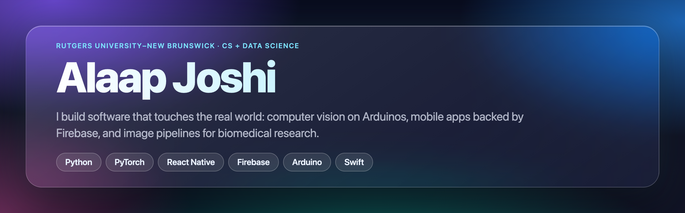
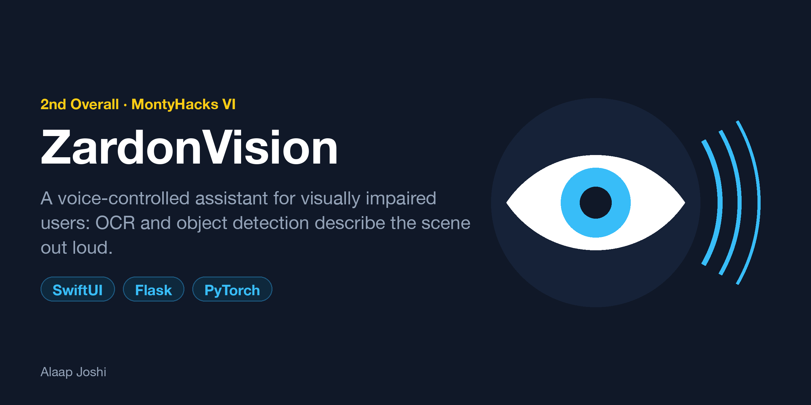
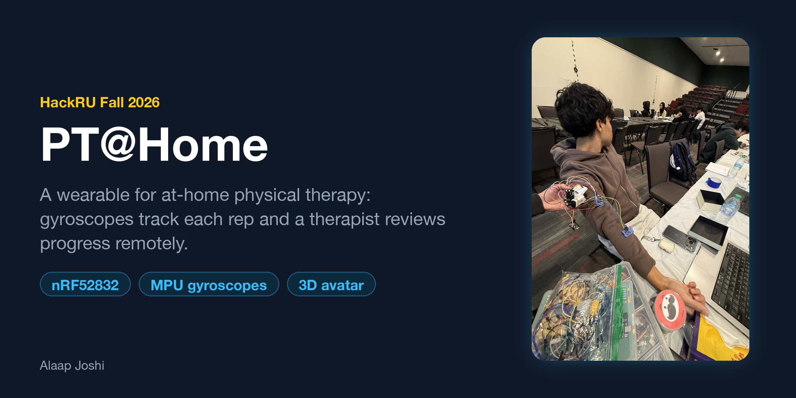

  

  I'm a Computer Science and Data Science student (class of 2028) and an undergraduate research assistant at Robert Wood Johnson Medical School. 
  I'm looking for software engineering and research internships.

  
  
  
  
  

  <b>15</b> hackathon awards &nbsp;·&nbsp; <b>22</b> hackathons competed &nbsp;·&nbsp; <b>Top 10</b> MIT Data Science Competition

---

### Pinned projects

<table>
  <tr>
    <td width="50%" valign="top">
      
      <h4><a href="https://github.com/alaapjoshi/Haven">Haven</a> · 1st Place Overall, MontyHacks VII</h4>
      DIY home security. An Arduino ultrasonic sensor trips the alarm, a webcam running YOLOv5 captures detections, and both feed Firebase and a React Native app.
        
      <a href="https://github.com/alaapjoshi/Haven">Code</a> · <a href="https://devpost.com/software/haven-nruqbz">Devpost</a>
    </td>
    <td width="50%" valign="top">
      
      <h4><a href="https://github.com/alaapjoshi/BinSense">Intellibin → BinSense</a> · 1st Place Sustainability, HackMHS</h4>
      A smart trash can that classifies waste with YOLOv5 and drives an Arduino to open the matching lid. Rebuilt as BinSense with confidence thresholds, cooldowns and a live HUD.
        
      <a href="https://github.com/alaapjoshi/BinSense">Code</a> · <a href="https://devpost.com/software/intellibin">Devpost</a>
    </td>
  </tr>
  <tr>
    <td width="50%" valign="top">
      
      <h4><a href="https://github.com/alaapjoshi/zardon-vision">ZardonVision</a> · 2nd Place Overall, MontyHacks VI</h4>
      An iOS app that reads text and describes scenes aloud for people with low vision, using Apple's Vision framework and a Flask image-captioning server.
        
      <a href="https://github.com/alaapjoshi/zardon-vision">Code</a> · <a href="https://devpost.com/software/zardon-vision">Devpost</a>
    </td>
    <td width="50%" valign="top">
      
      <h4><a href="https://github.com/alaapjoshi/SustainableSwap">SustainableSwap</a> · 2nd Place, MEGA Hackathon 2023</h4>
      A marketplace for used electronics parts that shows drive time to each listing and maps nearby repair shops.
        
      <a href="https://github.com/alaapjoshi/SustainableSwap">Code</a> · <a href="https://devpost.com/software/sustainableswap">Devpost</a>
    </td>
  </tr>
  <tr>
    <td width="50%" valign="top">
      
      <h4><a href="https://github.com/alaapjoshi/PT-Home">PT@Home</a> · HackRU Fall 2026</h4>
      Wearable IMU sensors that stream joint angles over Bluetooth Low Energy to a live 3D avatar in the browser. A prototype, not a medical device.
        
      <a href="https://github.com/alaapjoshi/PT-Home">Code</a> · <a href="https://devpost.com/software/pt-home">Devpost</a>
    </td>
    <td width="50%" valign="top">
      
      <h4><a href="https://github.com/alaapjoshi/robowatch">RoboWatch</a> · FRC Team 75, 2024 season</h4>
      A scouting app for FIRST Robotics: a six-step match form, a tap-to-log field map, QR handoff, Firestore upload and The Blue Alliance lookups.
        
      <a href="https://github.com/alaapjoshi/robowatch">Code</a>
    </td>
  </tr>
  <tr>
    <td width="50%" valign="top">
      <h4><a href="https://github.com/alaapjoshi/PaperPilot">PaperPilot</a></h4>
      Draw an instrument on paper, scan it with Gemini, and play it with your fingers through a live camera.
        
      <a href="https://github.com/alaapjoshi/PaperPilot">Code</a>
    </td>
    <td width="50%" valign="top">
      
      <h4><a href="https://github.com/alaapjoshi/Glob-ED">Glob-ED</a> · Track Winner, MEGA Hackathon 2023 Summer</h4>
      A free mobile learning app where students ask an AI tutor or connect with volunteer teachers.
        
      <a href="https://github.com/alaapjoshi/Glob-ED">Code</a> · <a href="https://devpost.com/software/glob-ed">Devpost</a>
    </td>
  </tr>
</table>

<b>More hackathon wins</b>

 

| Project | Award | Links |
|---|---|---|
| ZardonVision | 3rd Place Overall · PantherHack 2023 | [Devpost](https://devpost.com/software/zardon-vision-1rs6n2) |
| Crop Prophet | Innovator's Excellence Award · YouthCodeX | [Code](https://github.com/alaapjoshi/CropProphet) · [Devpost](https://devpost.com/software/crop-prophet) |
| TechCycle | Solo Prize · PeddieHacks 2023 | [Code](https://github.com/alaapjoshi/TechCycle) · [Devpost](https://devpost.com/software/techcycle) |
| Portel | Best Domain Name · hackPHS 2022 | [Code](https://github.com/alaapjoshi/Portel) · [Devpost](https://devpost.com/software/portel-g5l0pi) |

All projects: [devpost.com/alaapjoshi](https://devpost.com/alaapjoshi)

---

### Experience

- **Undergraduate Research Assistant**, Robert Wood Johnson Medical School (Jul 2026 – present): analyzed 250+ fluorescence microscopy images with Python, scikit-image and Cellpose; automated thresholding cut manual analysis time by 23%
- **Board Member**, Rutgers Organization of Cloud Computing (Jan 2026 – present): AWS and Azure curriculum and technical workshops

<b>Previously</b>

 

- **Software Engineering Intern**, Ipser Labs (Jun – Aug 2026): React Native scanning and validation workflows that digitized 1,000+ land-ownership and debt records; cut app bundle size by 11%
- **Tutor and Mentor**, theCoderSchool (May 2024 – Aug 2025): taught 60+ students across 200+ private and group sessions
- **App Development Lead**, FIRST Robotics Team 75 (2022 – 2024): React Native and Firebase scouting app
- **President**, Hillsborough High School Computer Science Club (2023 – 2024): programming workshops and hackathon teams

---

### Tech

**Languages** 

**Web and mobile** 

**ML and data** 
 

**Tools and hardware** 
 

---

  Off the keyboard: Inter Milan · tennis · golf · chess · tabla · rap and R&B · concerts · streetwear · sneakers

